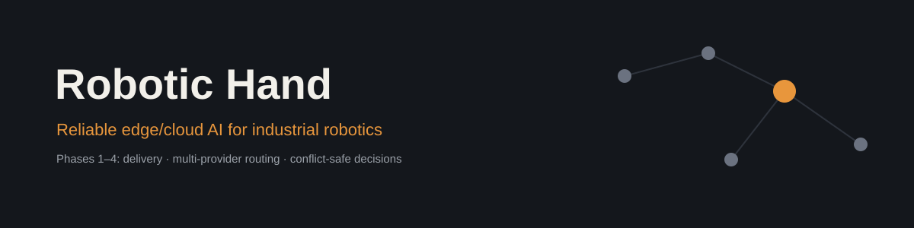
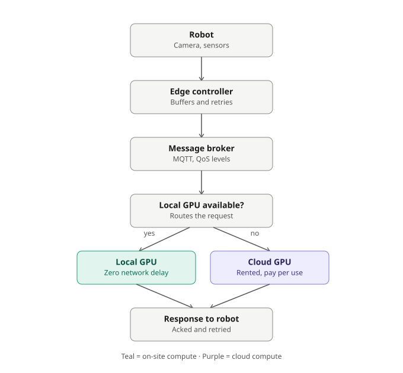
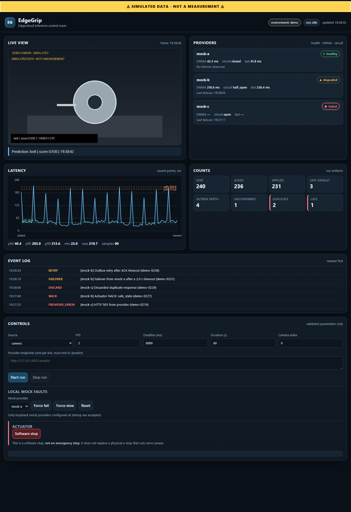

# Robotic Hand — Edge/Cloud AI Pipeline


Small manufacturers often cannot justify a dedicated on-site AI server for
vision-guided automation. This project keeps the robotic hand's motor control
and safety stops local, while the perception/decision step runs on whichever
compute is available — an on-site GPU when the factory has one, a rented cloud
GPU when it does not — connected by a durable MQTT path so a network drop does
not lose work in the failure modes that were tested. The repository is a
reference implementation of that split: camera capture, a SQLite outbox,
Mosquitto delivery, multi-provider routing, conflict-safe claims, a robot-side
decision gate, and a serial actuator protocol. Phase 6 adds the optional
tooling for one custom image-classification task: webcam dataset capture,
session-based splits, fine-tuning of a small pretrained classifier, a locked
test evaluation, and a `TASK=classification` mode on `real_server`. A local
FastAPI dashboard reads the run artifacts and controls a live run without a
build step or CDN. The firmware and the physical hand remain untested.

## Architecture



A frame is captured on the edge, written to a SQLite outbox as `pending`
*before* it is published, and sent over MQTT QoS 1. The worker deduplicates by
`task_id` and asks the router for a decision; the router checks provider
health, respects a circuit breaker, prefers the lowest recent latency, and
fails over sequentially within the task deadline. Results are claimed with
`INSERT … ON CONFLICT DO NOTHING`, so the first valid writer wins. The robot
gate applies a decision only if it is not already applied, the deadline has
not passed, and no newer frame has been decided; otherwise it falls back to a
safe default. A configurable policy maps the decision to at most one actuator
action, claimed in `actuation_log` before anything is sent.

More detail: [docs/ARCHITECTURE.md](docs/ARCHITECTURE.md).

## Phase status

| Phase | Built | Tested offline | Tested with broker/Docker or real cloud/hardware |
|---|---|---|---|
| **1 — baseline pipeline** | Yes | Yes — capture, mock HTTP inference, latency CSV | **No real cloud run.** No hosted provider was called. The local real-model server was attempted but did not start, so it produced no inference measurement. |
| **2 — reliable delivery** | Yes | Partial — outbox and message code are exercised by offline Phase 4 tests | **No local broker run recorded.** The Docker daemon was unavailable here, so all six Phase 2 broker tests skipped. A CI job is defined but has not run yet. |
| **3 — multi-provider routing** | Yes | Yes — in-process mock providers | **No local broker run.** The Phase 3 worker/router/broker integration test skipped with Docker unavailable. |
| **4 — conflict handling** | Yes | Yes — claim races, restarts and 1000-task worker path | Broker not required for these tests. No real-cloud run. |
| **5a — deployment harness** | Yes | Yes — token enforcement and client/provider token handling | **No real cloud deployment.** No VM was provisioned and no hosted endpoint was called. |
| **5b — actuation** | Yes | Yes — stub actuator, fake device, serial path over a fake transport | **No real hardware.** The firmware sketch has never been compiled, flashed or run; hardware-gated tests skipped. |
| **6 — custom classifier** | Yes | Yes — session split integrity, classification HTTP contract, low-score → `unknown` → `hold` with a fake classifier | **No real dataset, webcam capture or training run.** No photos were collected, no GPU/Colab/Kaggle job ran, and `docs/model_card.md` contains no accuracy number. |
| **7 — local dashboard** | Yes | Yes — demo APIs, token gate, bind rules, run validation, mock-fault refusal, stop label | **No live camera or real run.** The demo UI was launched and a real headless-Chrome screenshot was captured; Playwright is not installed, so its optional test skipped. |

## Test status

Collected from the repository with `python -m pytest --collect-only -q`
(109 tests). Statuses below are from the offline run in this workspace on
Windows 11 with Python 3.14.5:

```text
93 passed, 16 skipped
```

<!-- TEST_TABLE_START -->
| Test ID | Test file | Status |
|---|---|---|
| TC1.1 | tests/test_tc1_1_single_request.py | Passed (4 tests) |
| TC1.2 | tests/test_tc1_2_batch.py | Passed (3 tests) |
| TC1.3 | tests/test_tc1_3_known_label.py | Passed (3 tests) |
| TC1.4 | tests/test_tc1_4_failure.py | Passed (5 tests) |
| TC2.1 | tests/phase2/test_tc2_1_healthy.py | Skipped — Docker daemon unavailable locally |
| TC2.2 | tests/phase2/test_tc2_2_broker_restart.py | Skipped — Docker daemon unavailable locally |
| TC2.3 | tests/phase2/test_tc2_3_restart_pending.py | Skipped — Docker daemon unavailable locally |
| TC2.4 | tests/phase2/test_tc2_4_duplicate.py | Skipped — Docker daemon unavailable locally |
| TC2.5 | tests/phase2/test_tc2_5_retry_backoff.py | Skipped — Docker daemon unavailable locally |
| TC2.6 | tests/phase2/test_tc2_6_latency_overhead.py | Skipped — Docker daemon unavailable locally |
| TC3.1 | tests/phase3/test_tc3_router.py | Passed |
| TC3.2 | tests/phase3/test_tc3_router.py | Passed |
| TC3.3 | tests/phase3/test_tc3_router.py | Passed |
| TC3.4 | tests/phase3/test_tc3_router.py | Passed |
| TC3.5 | tests/phase3/test_tc3_router.py | Passed |
| TC3.6 | tests/phase3/test_tc3_extra.py | Passed |
| TC3.7 | tests/phase3/test_tc3_extra.py | Passed |
| TC3.8 | tests/phase3/test_tc3_extra.py, tests/phase3/test_tc3_refactor.py | Passed (2 tests) |
| TC3.9 | tests/phase3/test_tc3_extra.py | Passed |
| TC3-integration | tests/phase3/test_tc3_extra.py | Skipped — Docker daemon unavailable locally |
| TC3-unit | tests/phase3/test_tc3_refactor.py | Passed (circuit breaker and health-thread tests) |
| TC4.1 | tests/phase4/test_tc4_conflict.py | Passed |
| TC4.2 | tests/phase4/test_tc4_conflict.py | Passed |
| TC4.3 | tests/phase4/test_tc4_conflict.py | Passed |
| TC4.4 | tests/phase4/test_tc4_conflict.py | Passed |
| TC4.5 | tests/phase4/test_tc4_conflict.py | Passed |
| TC4.6 | tests/phase4/test_tc4_conflict.py | Passed |
| TC4.7 | tests/phase4/test_tc4_conflict.py | Passed |
| TC4.8 | tests/phase4/test_tc4_conflict.py | Passed |
| TC4.9 | tests/phase4/test_tc4_conflict.py | Passed |
| TC4.10 | tests/phase4/test_tc4_conflict.py | Passed |
| TC4.11 | tests/phase4/test_tc4_conflict.py | Passed |
| TC4.12 | tests/phase4/test_tc4_conflict.py | Passed |
| TC5a | tests/test_phase5a_token.py | Passed (6 tests) |
| TC5b.1 | tests/phase5b/test_tc5b_actuator.py | Passed |
| TC5b.2 | tests/phase5b/test_tc5b_actuator.py | Passed (12 tests) |
| TC5b.3 | tests/phase5b/test_tc5b_actuator.py | Passed (4 tests) |
| TC5b.4 | tests/phase5b/test_tc5b_actuator.py | Hardware-gated — skipped, no serial device |
| TC5b.5 | tests/phase5b/test_tc5b_actuator.py | Hardware-gated — skipped, no serial device |
| TC5b.6 | tests/phase5b/test_tc5b_actuator.py | Passed (3 tests) |
| TC5b.7 | tests/phase5b/test_tc5b_actuator.py | Passed (3 tests) |
| TC5b.8 | tests/phase5b/test_tc5b_actuator.py | Passed (3 tests) |
| TC5b-sim | tests/phase5b/test_tc5b_actuator.py | Skipped — optional pybullet package not installed |
| TC5b-live | tests/phase5b/test_tc5b_live_latency.py | Passed (3 tests) |
| TC6.1 | tests/test_phase6_classification.py | Passed (2 tests) — session split, manifest, duplicate and minimum-count failures |
| TC6.2 | tests/test_phase6_classification.py | Skipped — needs a webcam and physical parts; capture is a manual step |
| TC6.3 | tests/test_phase6_classification.py | Passed (2 tests) — classification contract over HTTP with a tiny fake classifier, offline |
| TC6.4 | tests/test_phase6_classification.py | Passed (2 tests) — low top score becomes `unknown`; policy holds |
| UI | tests/test_ui_dashboard.py, tests/test_ui_live_source.py | Passed (13 tests); optional Playwright screenshot skipped — package not installed |
| REAL-MODEL | tests/test_real_model.py | Skipped — RUN_REAL_MODEL not set; no model download or real inference run |
<!-- TEST_TABLE_END -->

`python -m scripts.check_docs` verifies that every test ID in this table maps
to a collected test and every collected test has a row.

## Phase 6 — one custom classification task

Phase 6 is optional tooling around the same edge/cloud contract. It does not
change Phase 1–5 behavior, and `TASK` defaults to `detection`.

1. **Capture** one class at a time from a webcam. Each photo is stored as
   `data/<class>/<session>_<n>.jpg`; the preview shows the live count for every
   class. `data/` is gitignored, so photos are never committed.

   ```bash
   python tools/capture_dataset.py bolt session01
   python tools/capture_dataset.py nut session02 --max-images 40
   ```

2. **Split by session**, never by random file. The manifest is validated before
   it is written; duplicate paths, a session in two splits, a class below the
   minimum, or fewer than three sessions per class all fail the command.

   ```bash
   python tools/split_dataset.py --data-dir data --manifest data/manifest.csv
   ```

3. **Fine-tune** a small pretrained classifier (`microsoft/resnet-18` in the
   example config). `metrics.csv` gets one row per epoch, early stopping watches
   validation, and only the best checkpoint is kept. The test split is not read
   by training. A CPU smoke test runs one epoch on a tiny subset.

   ```bash
   pip install -r requirements-training.txt
   python -m training.train --config config/train.classification.json --smoke
   python -m training.train --config config/train.classification.json
   ```

4. **Evaluate once** on the locked test split. This writes the accuracy,
   per-class precision/recall, confusion-matrix PNG and misclassified files into
   [docs/model_card.md](docs/model_card.md).

   ```bash
   python -m training.evaluate \
     --checkpoint training/runs/classifier/best \
     --manifest data/manifest.csv --data-dir data
   ```

5. **Serve classification** with the same contract used by the pipeline:
   `prediction`, `score`, `server_inference_ms` and the `X-Task-Id` echo. A top
   score below `CLASSIFICATION_THRESHOLD` (default `0.5`) returns
   `prediction: "unknown"`. Detection is unchanged and still the default.

   ```bash
   TASK=classification MODEL_ID=microsoft/resnet-18 \
     API_TOKEN=replace-with-a-real-token python -m real_server --port 8001
   ```

   `config/policy.classification.example.json` maps the example labels (`bolt`,
   `nut`, `washer`) and defaults to `hold`, so `unknown` or a low score sends
   nothing. Load it with `ACTUATION_POLICY_PATH`.

No dataset, training run or evaluation was produced in this repository. The
model card therefore reports no accuracy. Any number you see there in the
future came from a specific local dataset, not from this README.

## Phase 7 — local dashboard



This is a real headless-Chrome screenshot of `python -m ui --demo --port 8099`.
Every value in it is synthetic; the banner is part of the page, not an image
annotation.

```bash
# Demo data: no camera, broker, Docker or cloud endpoint
python -m ui --demo --port 8080

# Read the latest logs/live run artifacts read-only
python -m ui --port 8080

# Non-loopback bind needs both the explicit flag and API_TOKEN
API_TOKEN="$(python -c "import secrets; print(secrets.token_urlsafe(32))")" \
  python -m ui --host 0.0.0.0 --allow-remote --port 8080
```

The page is a single HTML/CSS/JS document served by FastAPI. Charts are drawn
with canvas and there are no CDN scripts, so it works offline. Panels show the
latest frame with prediction/score overlay, provider health/EWMA/circuit/last
failover, latency with p50/p95/p99, counts, events and actuation rows. Run
controls accept only typed parameters (`source`, `fps`, `deadline_ms`,
`duration`, `endpoints`, `camera`) and launch `live_run.py` as a separate
process with no shell. Mock fault buttons require a confirmation field and only
accept loopback providers configured at startup. The software stop is labelled
**not an emergency stop** in both the button and the API response.

Read [docs/UI.md](docs/UI.md) for the API, data sources and security notes.

## Measured results

Every number below is labelled with the environment that produced it. Nothing
here is a cloud-latency measurement. Full records are in
[docs/measurements.md](docs/measurements.md).

| Measurement | Value | Environment |
|---|---|---|
| Phase 1 round trip, 20 requests | avg 23.876 ms, min 6.039 ms, max 61.604 ms | **Loopback mock** (`127.0.0.1`, local FastAPI mock server) |
| Phase 3 worst-case failover | 6.808 ms | **Loopback mock** providers, local process |
| Phase 3 hanging-provider failover, 5 runs | min 2009.9 ms, median 2013.3 ms, max 2031.2 ms | **Loopback mock**, 2.0 s read timeout, one failover call |
| Phase 4 claim-path trials | 200 trials, 0 invariant violations | **Loopback mock** providers |
| Phase 4 1000-task worker run | 0 tasks applied more than once; 0 organic failures | **Loopback mock** providers and local SQLite |
| Real model (RT-DETR), local | 0 requests completed; server did not start | **Real model, local** — attempted, not executed |
| Real cloud inference | No run recorded | **Real cloud** — not tested |
| Actuator capture→ACK | No run recorded | **Real hardware** — not tested; stub/fake only |

## Claims audit

The repository was searched for absolute reliability wording. These were the
claims found, and what they now say:

| Original claim | Location | Replacement |
|---|---|---|
| "Zero data loss on disconnect" | README | "No message loss in the tested failure modes" |
| "exactly-once application" | README | "at most one application per task in the tested scenarios" |
| "100 messages … 0 lost" (test docstring) | tests/phase2/test_tc2_1_healthy.py | "100 messages all acked in this test" |
| "processed exactly once" | tests/phase2/test_tc2_4_duplicate.py, docs/measurements.md, tests/phase2/test_tc2_6_latency_overhead.py | "processed once in the duplicate-delivery test" |
| "100 messages no loss" | docs/PHASES.md | "100 messages all acked in the test" |
| "never dropped silently" | docs/PHASES.md, tests/phase4/test_tc4_conflict.py | "recorded in the discard log" |
| "same task is applied exactly once" | docs/PHASES.md | "the same task is not applied twice in the tested crash/restart scenarios" |

The durable outbox, QoS 1, ACK-driven retry, deduplication and claims are
tested against the failure modes listed in
[docs/TESTING.md](docs/TESTING.md). They are not a proof of losslessness for
untested failures such as storage corruption, a disk full during the claim
write, or a device that never returns an ACK.

## Known limitations

- **Single-machine SQLite claim store.** `results`, `discarded`, `applied_ids`
  and `actuation_log` live in one SQLite file. There is no replication or
  multi-machine consensus; two edge machines with separate databases are not
  covered.
- **Plain-HTTP tokens.** `real_server` authenticates `/predict` with an
  `X-API-Token` header over plain HTTP unless a TLS proxy is added. The token is
  not encrypted in transit by this code, and there is no key rotation.
- **COCO-only model.** The optional RT-DETR model
  (`PekingU/rtdetr_r18vd`) is COCO-trained and does not know factory-specific
  parts. The offline mock labels come from a hash manifest and measure plumbing,
  not accuracy.
- **Firmware untested on hardware.** The sketch in `firmware/` has never been
  compiled, flashed or run. Protocol behaviour is verified against
  `FakeDevice`, not the C++ implementation.
- **Broker and worker run on the edge machine.** Mosquitto and the worker are
  expected on the same machine as the capture process. Only inference endpoints
  are remote. This avoids WAN broker latency but is not a distributed
  deployment.
- **Mock-only latency unless real runs are recorded.** All latency and failover
  numbers above come from loopback mock servers. No real-cloud or real-provider
  latency was measured.
- **No hardware actuation was run.** No physical hand was moved. The `stop`,
  heartbeat safe state and limits are software behaviours and must not replace
  a physical e-stop that cuts servo power.
- **Optional simulation not exercised.** The PyBullet `SimActuator` test skips
  because `pybullet` is not installed in this environment.
- **No custom classifier result exists.** Phase 6 tooling is implemented and its
  offline tests pass, but no dataset was captured, no training job ran on a GPU
  or CPU, and no test-set evaluation was produced. `docs/model_card.md` says so.
- **The classification threshold is not a safety guarantee.** A confident wrong
  label can still pass the threshold. The policy's `hold` default only prevents
  action for labels without a rule; it does not validate the part is present.
- **The dashboard was not exercised against a live camera or real run.** Its
  data source was tested against synthetic artifacts and a temporary SQLite run
  snapshot. Live frames fall back to a labelled placeholder when the camera is
  unavailable or busy.
- **The dashboard `Software stop` is not an emergency stop.** It sends a
  software command only; it does not cut servo power. Use a physical e-stop.
- **Provider circuit state needs opt-in telemetry.** Runs launched from the
  dashboard set `ROUTER_TELEMETRY_PATH` automatically. For externally started
  runs, set it to the same JSONL path or the circuit state shows `unknown`.

## Quickstart (Windows PowerShell)

These commands were executed in this workspace. They install the offline
dependencies, create a local `.env`, and run the offline suite. The suite still
skips the real-model, broker/Docker and hardware cases as described above.

```powershell
python --version
python -m venv .venv
python -m pip install -r requirements.txt
Copy-Item .env.example .env
$env:SKIP_PHASE2_DOCKER_TESTS = "1"
python -m pytest --collect-only -q
python -m pytest -q
```

Start the deterministic mock inference server and check it:

```powershell
Start-Process python -ArgumentList '-m','mock_server','--port','8000' -PassThru
Start-Sleep -Seconds 4
(Invoke-WebRequest -UseBasicParsing http://127.0.0.1:8000/health).Content
```

The health response was:

```json
{"status":"ok","model":"mock-vit-b16","known_images":3}
```

Docker, broker, real-model and hardware commands are documented in
[docs/TESTING.md](docs/TESTING.md); they were not run in this workspace.

## Documentation

- [docs/ARCHITECTURE.md](docs/ARCHITECTURE.md) — diagram, data flow, deadlines
  and claim-before-send logic.
- [docs/TESTING.md](docs/TESTING.md) — offline, broker, real-model and
  hardware-gated test tiers.
- [docs/PHASES.md](docs/PHASES.md) — phase-by-phase implementation notes and
  commands.
- [docs/measurements.md](docs/measurements.md) — measured results with
  environment labels.
- [docs/device_protocol.md](docs/device_protocol.md) and
  [docs/hardware.md](docs/hardware.md) — serial protocol and hardware safety.
- [docs/model_card.md](docs/model_card.md) — Phase 6 evaluation template; it is
  overwritten by `training/evaluate.py` after a real run.
- [docs/UI.md](docs/UI.md) — dashboard APIs, demo mode, token/bind rules and
  live-run controls.

## License

MIT — see [LICENSE](LICENSE).
