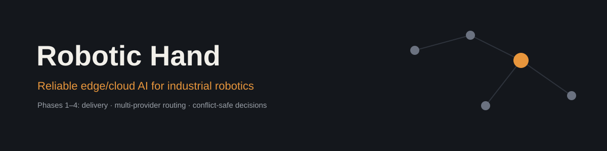
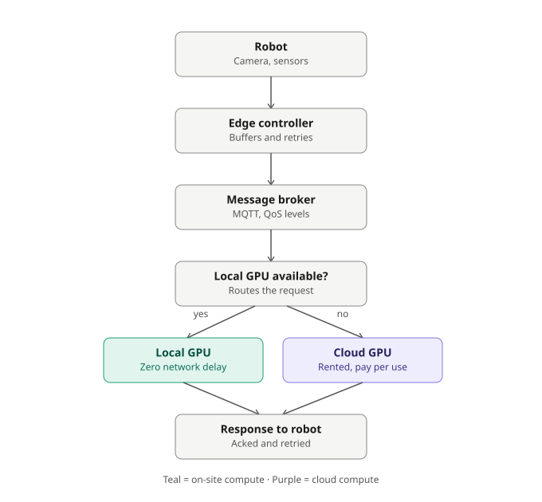

# Robotic Hand — Edge/Cloud AI Pipeline


AI-assisted robotic hand for small-scale industrial automation. Perception and decision-making run on whichever compute is available — an on-site GPU if the factory has one, a rented cloud GPU if it doesn't — connected through a reliable messaging layer so no sensor reading or command is lost if the network drops.

## Table of contents

- [Overview](#overview)
- [Features](#features)
- [Architecture](#architecture)
- [Tech stack](#tech-stack)
- [Getting started](#getting-started)
- [Project structure](#project-structure)
- [Reliability](#reliability-how-data-loss-is-actually-prevented)
- [Security](#security)
- [Monitoring](#monitoring)
- [Roadmap](#roadmap)
- [Contributing](#contributing)
- [License](#license)

## Overview

Most small manufacturers can't justify a dedicated on-site AI server just to add vision-guided automation. This project's premise: keep the robot hand's safety-critical motor control fully local, and let the perception/decision step run wherever makes sense — locally if the factory already has a GPU, in the cloud if it doesn't — without the robot ever losing data when the connection is unstable.

This repository documents that architecture as the reference for implementation.

## Features

- **Hybrid inference routing** — prefers local GPU compute when available, falls back to cloud automatically
- **Zero data loss on disconnect** — local buffering and durable message delivery, not best-effort
- **Safety-first local control** — motor control and e-stop logic never depend on the network
- **Hardware-agnostic cloud path** — works with any production-grade rented GPU inference service
- **Model sync** — local and cloud inference paths kept on compatible model versions

## Architecture



**Pipeline:**

1. **Robot** — camera and sensors capture data locally; motor control and safety stops run on-device, independent of network state.
2. **Edge controller** — timestamps and IDs every reading, queues it in a local durable buffer before attempting to send. This buffer is what prevents data loss during an outage.
3. **Message broker (MQTT)** — delivers data reliably using QoS levels, so a dropped connection doesn't mean dropped data.
4. **Router** — checks whether a local GPU is available and healthy; routes there first, falls back to cloud GPU otherwise.
5. **Local GPU / Cloud GPU** — runs the image processing and decision model.
6. **Response to robot** — result returns over the same acknowledged channel, with a timeout fallback to a safe default if nothing arrives in time.

## Tech stack

| Concern | Recommended | Notes |
|---|---|---|
| Edge compute | NVIDIA Jetson Orin Nano | ~$399 dev kit; local inference with zero network dependency |
| Messaging | MQTT — Mosquitto / EMQX, or AWS IoT Core / Azure IoT Hub | Self-host for control, managed for less ops overhead |
| Server-side queue | Kafka or RabbitMQ | Durable buffering in front of the inference service |
| Cloud inference | On-demand rented GPU | Must stay up continuously — not a free-tier research notebook |
| Transport | Wired Ethernet where possible | More reliable and lower-latency than shared WiFi |

## Getting started

> This describes the intended setup for the reference architecture. Update this section as the actual implementation lands.

**Prerequisites**
- An MQTT broker (local install or managed service)
- An edge device for the controller (e.g. Jetson Orin Nano) if testing the local-GPU path
- Access to a cloud GPU inference endpoint for the fallback path

**Planned setup**
```bash
# clone the repo
git clone https://github.com/your-org/robotic-hand.git
cd robotic-hand

# install broker (example: Mosquitto)
sudo apt install mosquitto mosquitto-clients

# configure the edge controller
cp config/edge-controller.example.yaml config/edge-controller.yaml
# edit config/edge-controller.yaml with your broker address and GPU endpoint

# run the edge controller
python edge_controller/main.py --config config/edge-controller.yaml
```

## Project structure

```
robotic-hand/
├── README.md
├── architecture-diagram.svg
├── banner.svg
├── edge_controller/       # local buffering, retry, routing logic
├── broker_config/         # MQTT broker configuration
├── inference/             # model code shared by local + cloud paths
├── config/                # example configuration files
└── docs/                  # additional design notes
```

## Reliability: how data loss is actually prevented

Individual packet loss within a connection is already handled by the transport layer (TCP, which MQTT and gRPC sit on top of) — packets lost mid-transmission are automatically detected and resent. The real risk is a **full connection drop**, and what happens to data generated during that gap.

| Layer | Mechanism | Failure it protects against |
|---|---|---|
| Edge controller | Local durable queue, written before every send attempt | Data loss during a network outage |
| Message broker | QoS 1/2 delivery guarantees, message IDs for dedup | Lost or duplicated delivery across an unstable link |
| Server-side | Persistent queue (Kafka/RabbitMQ) in front of inference | Dropped requests when processing is briefly backed up |
| Robot | Timeout + safe default behavior | Indefinite hang if no response ever arrives |

## Security

- TLS/mTLS on every connection between robot, broker, and processing endpoints
- Per-device certificates for authentication — don't leave factory-floor devices open on the network
- Confirm data residency/retention policy with the factory before any camera footage leaves the site

## Monitoring

Track and alert on:
- End-to-end latency (robot → decision → robot)
- Local vs. cloud routing ratio, and failover events
- Queue depth at the edge controller and server-side broker
- Retry rate and timeout rate

## Roadmap

- [ ] Edge controller reference implementation
- [ ] MQTT broker config + QoS policy
- [ ] Local GPU inference path
- [ ] Cloud GPU inference path + queue
- [ ] Hardware integration with the robot hand
- [ ] Field test in a single factory with no on-site GPU
- [ ] Field test in a factory with an on-site GPU

## Contributing

This project is in the design/architecture phase. Issues and pull requests proposing implementation, corrections to the architecture, or hardware integration notes are welcome. Please open an issue describing the change before submitting a large pull request.

## License

MIT — replace with your preferred license before publishing.
