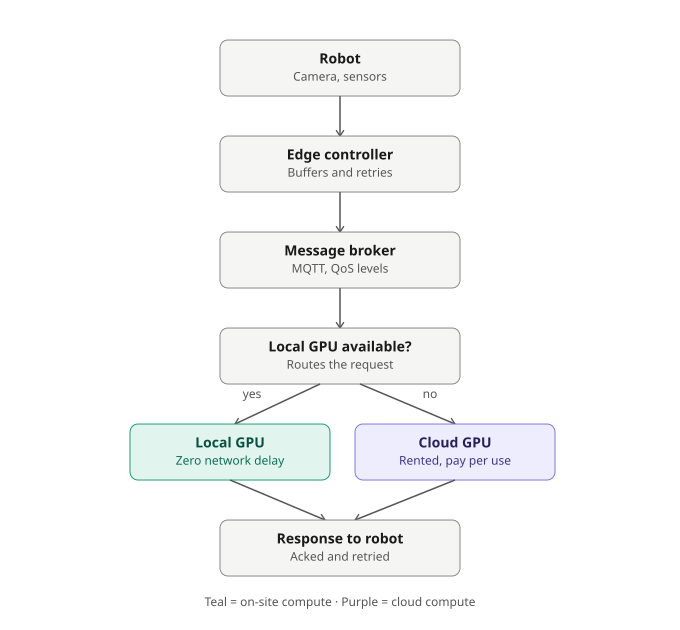
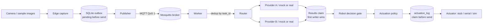

# Architecture

This document describes the implemented pipeline, the data that moves through
it, and the failure handling that the tests exercise. It is a description of
the code in this repository, not a production deployment guide.

## Diagram

The broker and worker are expected to run on the edge machine. Only inference
providers are remote.

## Data flow

1. **Capture.** `phase1_pipeline/capture.py` takes a frame from a camera or
   falls back to the bundled sample images. A `Frame` carries the JPEG bytes,
   a name and its dimensions.
2. **Outbox.** `phase2_reliability/outbox.py` inserts a row with state
   `pending` before any network call. The row includes a UUID4 `task_id`
   (also the message ID), the encoded frame, an attempt number, the frame
   timestamp and a deadline.
3. **Publish.** `phase2_reliability/publisher.py` publishes the message over
   MQTT QoS 1 and moves the row to `sent`. It subscribes to the ACK topic and
   moves the row to `acked` only when the worker acknowledges it. Unacked rows
   are resent oldest-first with exponential backoff (1 s, 2 s, 4 s, capped at
   30 s).
4. **Broker.** Mosquitto delivers the message to the worker. QoS 1 permits
   duplicates, so the worker must tolerate redelivery.
5. **Worker dedup.** `phase2_reliability/worker.py` records `task_id` in
   `processed_ids`. A duplicate is acknowledged again but not processed again.
6. **Routing.** `phase3_router/router.py` selects exactly one healthy provider,
   calls it sequentially, and fails over only if the attempt fails. Provider
   responses must echo the `task_id`; a mismatch is rejected and recorded.
7. **Claim.** The worker writes the decision to `results` with
   `INSERT … ON CONFLICT DO NOTHING`. The first valid writer wins; later
   responses are written to `discarded` with a reason (`duplicate`, `late`,
   `mismatch`).
8. **Decision gate.** `phase4_conflict/store.py` applies a decision only if it
   is not already in `applied_ids`, the deadline has not passed, and no newer
   frame has already been decided.
9. **Actuation.** `actuator/grip.py` maps `(label, score)` through a
   configuration policy to at most one action. The task is claimed in
   `actuation_log` before the command is sent, and the command ID is derived
   from the task ID.
10. **Device.** `actuator/protocol.py` frames commands as
    `command_id|command|parameters|checksum` and parses `ACK`/`NACK` replies.
    `FakeDevice` implements the same protocol for tests; `SerialActuator`
    speaks it over a serial port.

## Failure handling

| Failure | Handling | Verified by |
|---|---|---|
| Frame produced while the broker is down | Row stays `pending` in the outbox; publisher retries and drains oldest-first on reconnect | TC2.3 (broker/Docker; skipped locally) |
| Broker restarts | Unacked rows are resent; the worker re-ACKs duplicates | TC2.2 (broker/Docker; skipped locally) |
| Duplicate delivery | `processed_ids` dedup; duplicate ACK is re-sent without reprocessing | TC2.4 (broker/Docker; skipped locally) |
| Provider returns an error or times out | Router marks the attempt failed and moves to the next provider within the remaining deadline | TC3.2, TC3.3, TC3.4 |
| Provider hangs | Per-attempt read timeout derived from the deadline; failover to the next provider | TC3.8, TC4.9 |
| Every provider fails | Router returns a failure result; the gate may apply the safe default | TC3.4, TC4.7 |
| Two workers return different answers | First claim wins; the loser is recorded as `duplicate` | TC4.2, TC4.5 |
| Response arrives after the deadline | Gate refuses it and records `late`; safe default is used | TC4.7, TC4.12 |
| Worker crashes after inference, before ACK | Redelivery is deduplicated by `processed_ids`; the claim is already durable | TC4.10 |
| Edge process is killed mid-task | Restarted process sees the claim/`applied_ids` and does not apply twice | TC4.11 |
| Actuator duplicate command | `actuation_log` claim rejects a second action; the device's 32-command ring ACKs but does not re-execute | TC5b.3, TC5b.7 |
| Device does not answer | `SerialActuator` returns an unacknowledged result with reason `timeout`; it does not raise | TC5b.6 |
| Heartbeat stops | Firmware/FakeDevice drops to safe state and refuses motion until re-armed | TC5b.8 |

The tested scope is limited to these cases. Storage corruption, a full disk
during a write, and untested broker/network partitions are outside it.

## Deadlines

- Every task carries a `deadline` from the edge.
- The router computes each attempt's budget from the remaining deadline divided
  by the number of remaining providers, with a floor. The budget is split into
  connect and read timeouts.
- A provider that hangs consumes only its share; the next provider still gets a
  usable budget.
- After the deadline, the gate applies the configured safe default and refuses
  late answers. Late answers are logged, not applied.

TC4.9 measures the deadline-derived attempt timeout with two mock providers
(one hanging, one healthy, 1.5 s deadline). The committed numbers are in
[measurements.md](measurements.md).

## Claim-before-send logic

Three claims are made before an external side effect:

1. **Outbox before publish.** The `pending` row is committed before MQTT sees
   the frame. A crash between capture and send leaves a durable pending row,
   not an untracked frame.
2. **Result before application.** `INSERT … ON CONFLICT DO NOTHING` on
   `results` makes the first response the only one that can drive the robot.
3. **Actuation before command.** `actuation_log.task_id` is the primary key and
   the row is written before the actuator call. The command ID is derived from
   the task ID, so a retry after a crash reuses the same ID.

The actuation trade-off is deliberately fail-safe: a crash after the claim but
before the send leaves an unconfirmed row and no motion. The row is reported
for operator review; it is not retried automatically.

## Components

| Path | Responsibility |
|---|---|
| `phase1_pipeline/` | capture, HTTP client, benchmark and configuration |
| `phase2_reliability/` | outbox, publisher, worker, message format |
| `phase3_router/` | health checks, circuit breaker, EWMA preference, failover, providers |
| `phase4_conflict/` | task context, result claims, discard log, decision gate |
| `actuator/` | actuator interface, policy, actuation log, serial protocol, fake device |
| `mock_server/` | deterministic HTTP inference mock used by tests |
| `real_server/` | optional detection/classification endpoint with token auth |
| `tools/` | Phase 6 webcam capture and session-based dataset splitting |
| `training/` | Phase 6 fine-tuning, locked-test evaluation and model card |
| `config/` | Phase 6 training config and classification policy example |
| `ui/` | Phase 7 FastAPI dashboard, demo/live sources and static page |
| `phase3_router/telemetry.py` | opt-in, non-blocking JSONL provider telemetry for the dashboard |
| `firmware/` | untested ESP32/Arduino sketch |
| `benchmarks/` | loopback router overhead benchmark |
