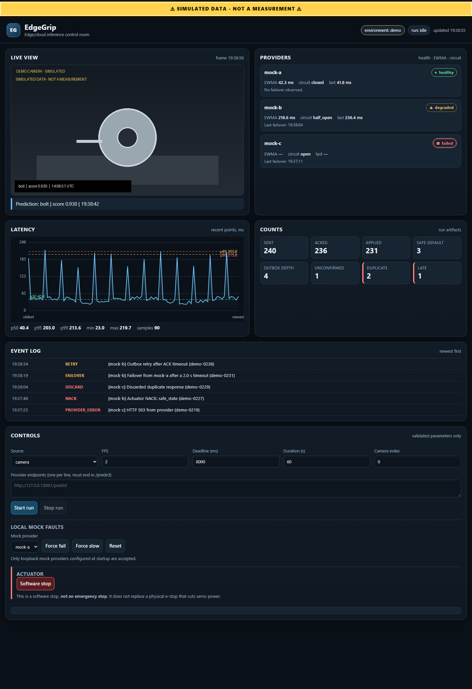

# Local dashboard

The dashboard is a single FastAPI page with plain HTML, CSS and JavaScript. It
reads the existing run artifacts and never requires a CDN, build step or cloud
service. Charts are drawn with canvas.



That image is a real headless-Chrome screenshot of `python -m ui --demo`.
Every value is synthetic and the banner is part of the page. It is not a
measurement and was not produced by a live run.

## Start

```bash
# Demo: synthetic data, no camera/broker/Docker/cloud
python -m ui --demo --port 8080

# Read the latest artifacts under logs/live and the default SQLite files
python -m ui --port 8080

# Non-loopback bind: both an explicit flag and the same token as real_server
export API_TOKEN="$(python -c 'import secrets; print(secrets.token_urlsafe(32))')"
python -m ui --host 0.0.0.0 --allow-remote --port 8080
```

The default bind is `127.0.0.1:8080`. A non-loopback bind is refused unless
`--allow-remote` is present **and** `API_TOKEN` is set. The token is checked
against the `X-API-Token` header on `/api/*` and `/stream/*`, with the same
mechanism as `real_server`. The page prompts for it and keeps it in
`sessionStorage`; it is never rendered into the page, a URL or a log, and
`/stream/frame` is fetched with a header rather than a query parameter.

`GET /healthz` is public and reports only status, demo mode and whether auth is
required. Static assets and `/` are public; they reveal no run data.

## Layout

- Header: environment label, run status, connection timestamp.
- Live view: latest JPEG at about 1 fps with prediction/score overlay.
- Providers: health, EWMA latency, circuit state and last failover.
- Latency: canvas chart with p50/p95/p99 reference lines and a text summary.
- Counts: sent, acked, applied, safe default, outbox depth, unconfirmed and
  discarded-by-reason.
- Event log: failover, retry, discard, NACK and provider errors.
- Controls: validated run start/stop, local mock faults and a software stop.

Provider health uses a glyph, a written label and a border style (solid,
dashed, double, dotted) as well as color. The demo banner is sticky and repeated
in the simulated frame overlay.

## Demo mode

`--demo` builds deterministic state in memory: three providers (healthy,
degraded, failed), synthetic latency points, events, actuation rows and a
painted camera frame. Run start/stop and mock faults update the demo state but
never spawn `live_run.py` or contact a provider.

Every `/api/state` response in demo mode contains:

```json
{
  "demo": true,
  "environment": "demo",
  "banner": "SIMULATED DATA - NOT A MEASUREMENT"
}
```

The server also inserts that banner into the HTML, so it is visible even if the
JavaScript poll has not run.

## Read-only live data

`LiveSource` reads the newest directory under `logs/live/` and the existing
SQLite files with `mode=ro` URIs:

| Data | Source |
|---|---|
| outbox depth and sent/acked | `outbox.db` (`outbox` states) |
| applied, safe default, discard reasons | `conflict.db` (`applied_ids`, `results`, `discarded`) |
| NACK/unconfirmed counts and rows | `conflict.db` (`actuation_log`) |
| latency points and per-provider EWMA | `latency.csv` |
| failover, retry, discard, NACK events | telemetry JSONL + the databases/CSV |
| broker status | TCP connect to `MQTT_BROKER_HOST:MQTT_BROKER_PORT` |
| frame | webcam if available; otherwise a labelled unavailable placeholder |

If a file is missing, the API returns zero or `unknown`; it does not invent a
value. During a live run the child process may hold the webcam; the dashboard
then shows a clearly labelled "camera unavailable or busy" frame rather than a
fake image. For an externally started run, enable provider telemetry by setting
`ROUTER_TELEMETRY_PATH` before `live_run.py`:

```bash
export ROUTER_TELEMETRY_PATH=logs/ui/router_telemetry.jsonl
python live_run.py --endpoints http://127.0.0.1:8001/predict
```

The writer is non-blocking: a bounded queue and daemon thread drop telemetry if
the disk cannot keep up. With the variable unset, Phase 3 behavior is unchanged.
Runs launched from the dashboard set this variable and truncate the file at
start. Circuit state is `unknown` when no telemetry exists.

The live frame score comes from the opt-in telemetry's last successful
provider result when one is available. Without telemetry it is `n/a`; the frame
never displays a fabricated score.

## API

| Method | Path | Purpose |
|---|---|---|
| GET | `/api/state` | providers, broker, counts, environment, run status, banner |
| GET | `/api/latency` | recent points plus p50/p95/p99/min/max |
| GET | `/api/events?limit=100` | failover, retry, discard and NACK events |
| GET | `/api/actuation?limit=50` | recent `actuation_log` rows |
| GET | `/stream/frame` | one JPEG at low fps, with overlay |
| POST | `/api/run/start` | spawn `live_run.py` with validated parameters |
| POST | `/api/run/stop` | stop that separate process |
| POST | `/api/mock/{provider}/{fail\|slow\|reset}` | local mock control, confirmation required |
| POST | `/api/stop` | software actuator stop, explicitly not an emergency stop |

### Run start body

```json
{
  "source": "camera",
  "fps": 2,
  "deadline_ms": 8000,
  "duration": 60,
  "camera": 0,
  "endpoints": ["http://127.0.0.1:8001/predict"]
}
```

Unknown keys are rejected. Ranges: `fps` 0.1–30, `deadline_ms` 100–60000,
`duration` 1–3600, camera 0–16, at most 8 endpoints. Each endpoint must be an
HTTP(S) URL whose path ends in `/predict`; whitespace is rejected. Outside demo
mode at least one endpoint is required. The server builds an argument vector
with `shell=False`; it never accepts an arbitrary command.

One run at a time. In live mode `POST /api/run/stop` terminates the child
process; it is not a graceful in-flight drain. The child's stdout/stderr goes to
`logs/ui/run_<id>.log`.

### Mock faults

Only providers configured at startup are accepted:

```bash
python -m ui --demo --mock-provider mock-a=http://127.0.0.1:8002
```

The URL must be loopback. `/slow` accepts `{"confirm": true, "ms": 1500}`.
Missing confirmation returns 400; a provider not in the local registry returns
403. This endpoint is a demo/test aid, not a production control plane.

### Software stop

`POST /api/stop` returns `not_an_emergency_stop: true`. In demo mode it only
changes demo state. In live mode it sends `stop` through `SerialActuator` only
when `ACTUATION_SERIAL_PORT` is configured; otherwise it reports that no command
was sent. It does not cut servo power and must not replace a physical e-stop.

## Tests

```bash
python -m pytest tests/test_ui_dashboard.py tests/test_ui_live_source.py -q
# 13 passed, 1 skipped
```

The skipped test is the optional Playwright screenshot. The rest need no
browser. A live camera, a real `live_run.py` child and real hardware were not
verified in this workspace.
