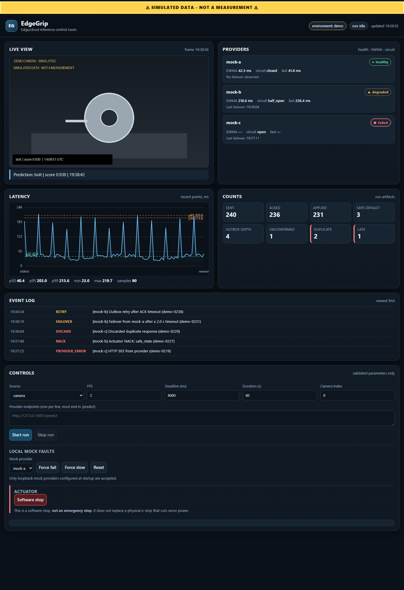

# firmware/ — device sketch (ESP32 / Arduino)

> ## ⚠️ UNTESTED — this firmware has never been compiled, flashed or run on
> ## real hardware.
>
> It is a first sketch for the Phase 5b device protocol, written against the
> protocol in [`../docs/device_protocol.md`](../docs/device_protocol.md). The
> Python side is tested against `FakeDevice`; this C++ side is not tested at
> all. Treat it as a starting point and expect to fix compile errors and tune
> the constants on the bench. Do not connect a loaded hand or put hands near
> the mechanism until the checklist in [`../docs/hardware.md`](../docs/hardware.md)
> has been completed on the real device.

## What it implements

- `command_id|command|parameters|checksum` frames, FNV-1a 32-bit checksum.
- ACK / NACK replies with a reason (`checksum`, `format`, `unknown_command`,
  `invalid_parameter`, `limit`, `safe_state`).
- Angle limits 0–180°, speed limits 1–100%, default speed 30%.
- The last 32 accepted command ids; duplicates are ACKed with
  `detail=duplicate` and not executed again.
- Boots in a safe state with both servos detached. The first valid heartbeat
  attaches them at their current position; motion commands are NACKed with
  `safe_state` until then.
- If no heartbeat arrives for `HEARTBEAT_TIMEOUT_MS` (2 s by default), both
  servos are detached and motion is refused until a heartbeat arrives.
- Motion steps one degree at a time from `loop()`, so the serial port keeps
  being serviced and heartbeats keep the watchdog fed during long moves.

## Files

```
firmware/robotic_hand/robotic_hand.ino   # the sketch
firmware/README.md                        # this file
```

## Board support and libraries

| Board | Library | Default pins | Notes |
|---|---|---|---|
| ESP32 | `ESP32Servo` | wrist 18, gripper 19 | Recommended; plenty of RAM for the 32-id ring |
| Arduino Uno/Nano (AVR) | `Servo` (bundled) | wrist 9, gripper 10 | The 32 × 37-byte id ring uses ~1.2 KB of 2 KB SRAM; it may fit but leaves little room. Prefer ESP32. |

The sketch selects the library and pins with `ARDUINO_ARCH_ESP32`. Change
`WRIST_PIN` / `GRIPPER_PIN` and the `GRIP_ANGLE` / `RELEASE_ANGLE` calibration
values for your mechanism.

## Flashing

Arduino IDE:

1. Open `firmware/robotic_hand/robotic_hand.ino`.
2. Select the board and port.
3. Install `ESP32Servo` from Library Manager if you use an ESP32.
4. Upload, then open Serial Monitor at **115200 baud**.

`arduino-cli` example (adjust FQBN/port):

```bash
arduino-cli core install esp32:esp32
arduino-cli lib install ESP32Servo
arduino-cli compile --fqbn esp32:esp32:esp32 firmware/robotic_hand
arduino-cli upload  --fqbn esp32:esp32:esp32 -p COM5 firmware/robotic_hand
```

## First bench checks (one at a time, hand unloaded)

From the host with `ACTUATION_SERIAL_PORT` set:

```bash
export ACTUATION_SERIAL_PORT=COM5          # or /dev/ttyUSB0
python - <<'PY'
from actuator import SerialActuator
a = SerialActuator("COM5")
a.start_heartbeat()                        # keeps the watchdog fed
a.heartbeat()                              # must be ACK; arms the device
print("grip:", a.grip(speed=10))            # slow, nothing in the gripper
print("release:", a.release(speed=10))
print("stop:", a.stop())
a.close()
PY
```

Then, still unloaded:

1. `move_to(angle=5, speed=5)` and watch the wrist move slowly; repeat with
   small increments.
2. Send `angle=181` and confirm a `NACK ... limit` — the servo must not move.
3. Send the same `command_id` twice and confirm the second reply contains
   `duplicate`.
4. Stop sending heartbeats for more than 2 s and confirm the servos go limp
   (safe state), then send a heartbeat and confirm motion is accepted again.
5. Only after the dry checks, follow the full first-run safety checklist in
   [`../docs/hardware.md`](../docs/hardware.md).

The hardware-gated pytest cases (`tests/phase5b` TC5b.4/TC5b.5) only send
heartbeat/stop and duplicate-stop; they never move the hand.

## Known limitations of this sketch

- **Never compiled or run.** Syntax, library APIs and pin choices are
  unverified.
- No position feedback, current sensing or force control. A hobby servo cannot
  report a missed move or a stall.
- No authentication or encryption; the checksum detects corruption, not
  tampering. The serial link is assumed to be a short, trusted cable.
- No flow control: the AVR serial RX buffer is small, so the host must send
  one command and wait for the reply. `SerialActuator` does exactly that.
- The safe state detaches the servos. That removes torque but does not brake a
  mechanism that is already moving under gravity.
- `HEARTBEAT_TIMEOUT_MS`, angles and speeds must match
  `actuator/protocol.py`; the two are kept in sync by hand.

## Project dashboard (demo data)

This screenshot is the project-level EdgeGrip dashboard, **not** validation of
the firmware. It was captured from `python -m ui --demo`; every value is
synthetic, and no hardware was connected. The firmware above remains
uncompiled and untested.



See the root [README](../README.md) and [UI guide](../docs/UI.md) for the
dashboard setup and limitations.
